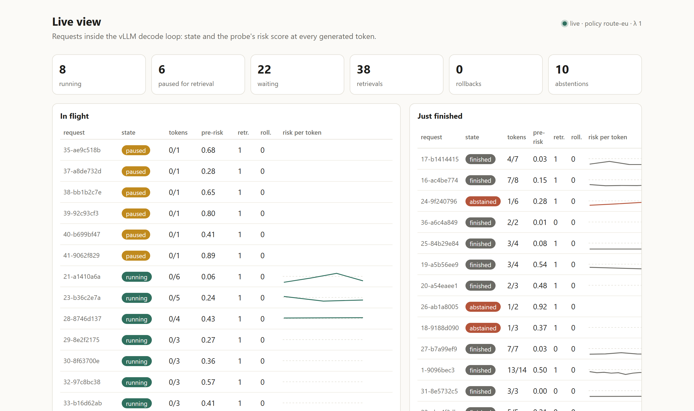
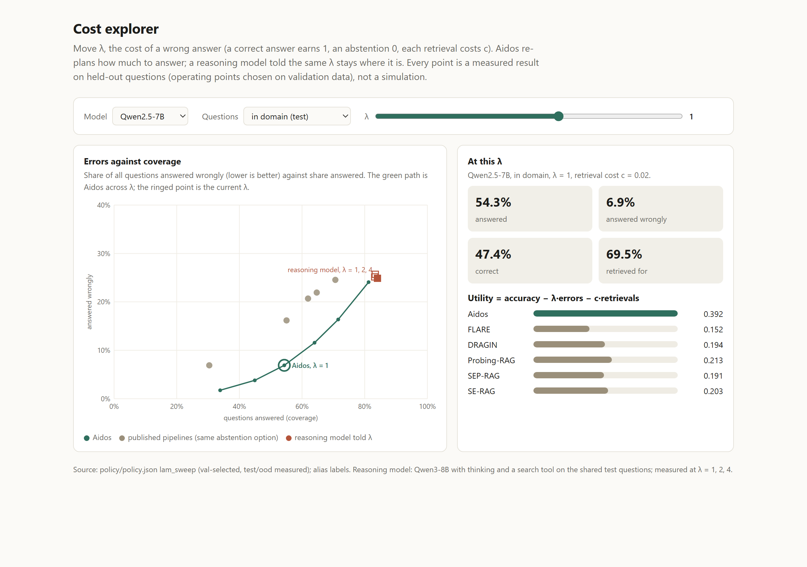

# Aidos: answer, retrieve or abstain from inside the vLLM decode loop

Aidos is a plugin for **vLLM V1** that decides, inside the engine, whether a request should answer, fetch
evidence, or decline to answer. It scores small linear probes on the model's hidden states at every decoding step
and acts on them in the scheduler:

- **Decide at prefill** whether to answer, retrieve or abstain, from one cost parameter λ (how much a wrong answer
  costs relative to a right one).
- **Pause and insert:** a request that needs evidence is paused with its KV cache intact while the rest of the
  batch keeps decoding; the evidence is appended as tokens and only those tokens are prefilled.
- **Roll back** the KV cache mid-answer without retracting text already sent to the client.
- **Exact:** insertion and rollback produce the same tokens as recomputing from scratch, including with tensor
  parallelism. `aidos verify` checks this on your own GPU and vLLM build.

It is a plugin, not a fork: it does nothing unless `AIDOS_CONFIG` is set. Calibrated heads ship for six models.

This repository accompanies the system demonstration paper (under review).

**Try it in your browser, no GPU needed: https://belgium-waffle.github.io/aidos1/** (live-view replay, cost explorer,
exactness checks).

| | |
|---|---|
|  |  |
| **Live view**: requests paused for retrieval, decoding, or abstained, with per-token risk. | **Cost explorer**: move λ and watch coverage and errors move (measured results). |

## Install

```bash
git clone https://github.com/belgium-waffle/aidos1
cd aidos1/aidos-vllm
pip install -e ".[bm25]"
aidos info
python examples/quickstart.py
```

Requires vLLM 0.21.x (pinned) and a CUDA GPU (tested on H100 and H200). The head bundles are in
`aidos-vllm/bundles/` in the clone. Full usage, retrievers and the Python API: [aidos-vllm/README.md](aidos-vllm/README.md).

## Quick start

From `aidos-vllm/`, serve any of the released models behind vLLM's OpenAI-compatible API:

```bash
aidos config bundles/qwen2.5-7b-instruct --lam 1 --retriever my_corpus.jsonl \
    --status aidos_status.json -o aidos.json
AIDOS_CONFIG=$PWD/aidos.json vllm serve Qwen/Qwen2.5-7B-Instruct \
    --scheduler-cls aidos.engine.scheduler.AidosScheduler --no-async-scheduling
```

`my_corpus.jsonl` holds `{"title", "text"}` lines (BM25 is built in memory); a precomputed cache, a BM25 index
directory, or your own search function also work. An abstention comes back with stop reason `aidos_abstain`.

Demo tools:

```bash
aidos live --status aidos_status.json    # live view
aidos lambda                             # cost explorer
aidos verify --model Qwen/Qwen2.5-7B-Instruct --bundle bundles/qwen2.5-7b-instruct
```

## Released heads

| Bundle | Model |
|---|---|
| `qwen2.5-7b-instruct` | Qwen/Qwen2.5-7B-Instruct |
| `llama-3.1-8b-instruct` | meta-llama/Llama-3.1-8B-Instruct |
| `mistral-7b-instruct-v0.3` | mistralai/Mistral-7B-Instruct-v0.3 |
| `qwen2.5-32b-instruct` | Qwen/Qwen2.5-32B-Instruct |
| `llama-3.3-70b-instruct` | meta-llama/Llama-3.3-70B-Instruct (tensor parallel 2) |
| `qwen3-8b` | Qwen/Qwen3-8B (thinking off) |

Each bundle is calibrated for λ ∈ {0.1, 0.25, 0.5, 1, 2, 4}.

## Results in the paper

Short-answer QA (TriviaQA and PopQA in domain; NQ, HotpotQA, 2WikiMultihopQA and SciQ out of domain), five models
from 7B to 70B. Source tables are in [paper/results](paper/results); see [paper/README.md](paper/README.md).

- **Exactness.** Eight engine checks (observe-only equals vLLM; evidence at prefill; mid-answer insertion, also with
  300 ms retrieval latency and on the recompute path; rewind; a second retrieval; forced rollbacks) match
  recomputation on all 24 prompts per check on every model, including tensor-parallel 70B. A mismatch is
  tolerated only at a bf16 near-tie (the reference's runner-up token, margin below 1 nat); this happened once
  (Qwen2.5-7B, second retrieval, 23 of 24 exact). Re-run from this package on a fresh node: all eight checks pass,
  24 of 24 each.
- **Answer quality.** Against five adaptive-retrieval pipelines run in the same engine with the same retriever
  (FLARE, DRAGIN, Probing-RAG, SEP-RAG, SE-RAG, each also given an abstain option), Aidos has higher utility in 75
  of 75 paired comparisons on the test split and 48 of 48 on a sealed held-out set, with 0.40–0.57 times the
  hallucination rate of the strongest baseline.
- **Against reasoning models** told the same cost of an error: Aidos adapts how much it answers (wrong on 6.9% /
  3.8% / 1.7% of questions at λ = 1 / 2 / 4, against about 25% at every λ for Qwen3-8B with search) and answers
  6–21 times faster.
- **Overhead.** Per decoding step 1.8–2.9% at 32–70B and 9–10% at 7–8B. End to end at 7B: 2–3% fewer requests per
  second than vLLM with the same synchronous scheduling, plus about 5% from giving up vLLM's asynchronous
  scheduling.
- **Serving throughput** (Qwen2.5-7B, one H100, 256 concurrent requests, cached retrieval): at λ = 1, a third more
  requests per second than retrieving for every question, with a hallucination rate of 8% instead of 33%; at
  λ = 0.25, within one point of always-retrieve accuracy at half its hallucination rate. *These throughput numbers
  come from a 2,000-question test subset that over-represents TriviaQA; numbers on the full test split will
  replace them.*

## Limitations

- Short-answer QA; mid-answer insertion does not beat retrieving up front on long answers.
- Synchronous scheduling is required; no speculative decoding or pipeline parallelism.
- Heads are trained per model; the hallucination-budget guarantee assumes questions like the calibration data and
  does not hold under distribution shift.
- Pinned to vLLM 0.21; re-run `pytest aidos-vllm/tests/test_vllm_contract.py` and `aidos verify` after an upgrade.

## Repository layout

```
aidos-vllm/        the pip package: plugin, scheduler, kernel, CLI, demo tools, head bundles, tests, examples
paper/figures/     figures in the paper
paper/results/     the measurements behind them (verify, serve check, live-view recording, throughput, answer quality)
paper/scripts/     scripts that turn the results into the figures, replay the live view and build the site
docs/              the browser demo site (GitHub Pages), built by paper/scripts/build_site.py
```

## License

MIT (see [LICENSE](LICENSE)).

## Citation

Paper under review; citation to follow.
